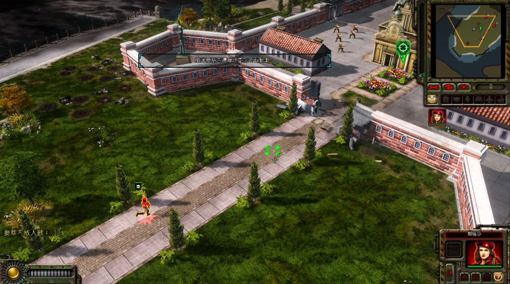
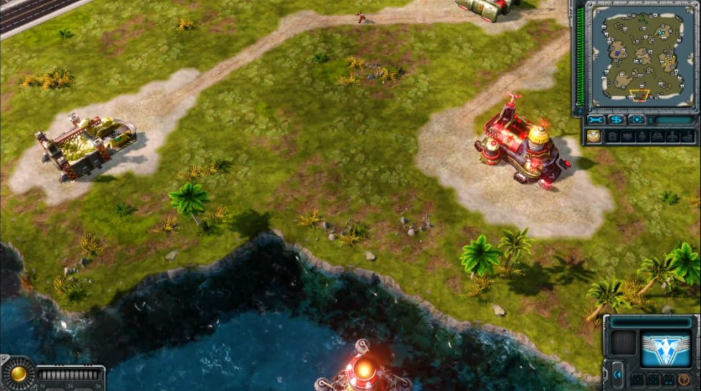
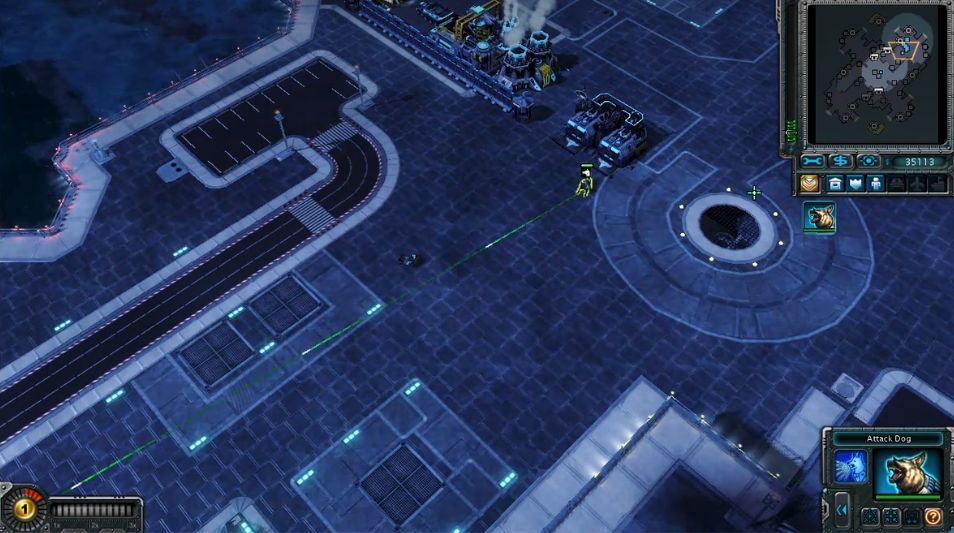

# Red Alert 3 — Native Recompilation

**[简体中文](README.zh-CN.md)**

[](https://github.com/HolyCaonima/ra3-ios-android-win-mac-recomp/actions/workflows/public-check.yml)
[](LICENSE)
[](https://space.bilibili.com/3546857907162034)

**Static recompilation of Red Alert 3's x86 execution logic to C, exploring native execution on iPad, Android, Windows and macOS.**

From a completed Windows skirmish to Android battlefields, keyboard and mouse control on Apple Silicon, and the Soviet campaign on iPad: this repository shares the methods, resource tools, lifter extensions, host components and graphics patches developed along the way.

**November 15, 2026 · New iPad ↔ Mac LAN footage shows both devices joining a room and entering the battlefield.** [Watch ↗](https://www.bilibili.com/video/BV1tZsH6gEGb/)

> Original project code and documentation use MIT. Game resources, generated lift C and game packages are excluded. Third-party patches retain upstream licensing; game imagery in the documentary screenshots is outside MIT. These are reusable engineering components, not yet a complete one-command game build.

## On real devices

[](https://www.bilibili.com/video/BV1E7sV6vEfn/)

*iPad · Soviet campaign, mission one. Click a picture for its source video.*

| Android · Base and battlefield | macOS · Selection and movement |
| :---: | :---: |
| [](https://www.bilibili.com/video/BV1qDsE67ECV/) | [](https://www.bilibili.com/video/BV1jws56vE25/) |

<details>
<summary><strong>iPad ↔ Mac · Both devices in the battlefield</strong></summary>
<br>
<p align="center">
  <a href="https://www.bilibili.com/video/BV1tZsH6gEGb/"></a>
</p>
</details>

*Stills from the maintainer's [public development videos](https://space.bilibili.com/3546857907162034), for progress documentation. [Sources and timestamps](docs/SCREENSHOTS.md).*

## Current progress

As of **November 15, 2026**. Platform results come from development tests and recordings; public CI independently tests tools and synthetic cases.

| Platform / subsystem | Observed result | Next validation |
| --- | --- | --- |
| **Windows x86** | A complete 1.12 skirmish played | More maps and endurance |
| **Android ARM64** | Menus, intro audio, battlefield and unit selection | Complete match, resume regression |
| **macOS · Apple Silicon** | Terrain / HUD, keyboard, mouse, animated cursors | Complete match and rendering coverage |
| **iOS / iPad ARM64** | Campaign interaction; one device retest passed after the GPU lifetime fix | Endurance and retention cost |
| **iPad ↔ Mac LAN** | Same room and both devices in the battlefield | Full-match synchronization, original Windows interoperability |
| **Public components** | Resource tools, host components, 14 DXVK patches, MoltenVK fix | More original modules and integration |

Full x86 memory-order guarantees on ARM64 remain unresolved. See [status and evidence](docs/STATUS.md).

## Start here

**No game files are needed for the public tests.** Install Python 3.10+, Git, CMake 3.16+ and a C compiler. The complete host test suite runs on macOS / Linux.

```sh
git clone https://github.com/HolyCaonima/ra3-ios-android-win-mac-recomp.git
cd ra3-ios-android-win-mac-recomp
python3 -m venv .venv
. .venv/bin/activate
python -m pip install -r requirements.txt
python -B tools/verify.py
```

Start with the [component guide](docs/TOOLS.md), or the [DXVK](tools/dxvk/README.md) and [MoltenVK](tools/moltenvk/README.md) patch instructions.

## The route

1. Pin local inputs by version and hash; resolve matching resource configuration chains.
2. Extend instruction translation for SSE integer operations, atomic read-modify-write and nonlocal jumps. Reject unsupported instructions explicitly.
3. Separate guest state from host address spaces, files, threads and input.
4. Adapt graphics for optional mobile GPU extensions, sampler specialization, surface lifetime and coordinate mapping.
5. Handle Apple-specific Metal surfaces, vertex strides and GPU buffer ownership.
6. Move from synthetic tests and focused differential checks to device interaction, complete matches and endurance.

[Method](docs/METHOD.md) · [Architecture](docs/ARCHITECTURE.md) · [Porting notes](docs/PORTING-NOTES.md)

## In this repository

| Path | Contents |
| --- | --- |
| [`tools/resources/`](tools/resources/) | BIG / CSF helpers, RefPack decompression, SkuDef resolution; no resource payloads |
| [`tools/versions/`](tools/versions/) | Local plaintext Steam depot manifest reader; no account or service access |
| [`tools/lift/`](tools/lift/) | Atomic and SSE lifter extensions, setjmp / longjmp transform, PE32 import inspection |
| [`runtime/hle/`](runtime/hle/) | UDP discovery transport and UTF-16 path combination |
| [`hosts/`](hosts/) | CUR / ANI decoder, Apple Bonjour and Android NSD bridges |
| [`tools/dxvk/`](tools/dxvk/) | **14 platform patches**, external build script, iOS stride regression check |
| [`tools/moltenvk/`](tools/moltenvk/) | iOS buffer lifetime patch, build script, native Metal probe |
| [`cmake/`](cmake/) · [`examples/`](examples/) | Dev / Release profiles and standalone example |
| [`tests/`](tests/) · [`tools/shotdiff.py`](tools/shotdiff.py) | Synthetic tests, image comparison and publication checks |

Complete host integration and some runtime dependencies are not included yet. The [component guide](docs/TOOLS.md) specifies what runs independently; [PUBLICATION.json](PUBLICATION.json) records each file's provenance.

## Next steps

- Complete device matches and endurance runs on Android, macOS and iPad.
- Check cross-platform synchronization and original Windows interoperability separately.
- Improve ARM64 memory semantics, graphics compatibility and resource lifetimes.
- Publish more reusable original runtime modules and tests, and connect the public components.

## License and acknowledgments

Original code and documentation: **[MIT](LICENSE)**. DXVK patches retain the zlib/libpng license; MoltenVK patches retain Apache-2.0. See [THIRD_PARTY.md](THIRD_PARTY.md) and [LICENSES/](LICENSES/). Game imagery and trademarks belong to their respective rightsholders. Independent project, unaffiliated with Electronic Arts. [Publication scope](LEGAL.md) · [Contributing](CONTRIBUTING.md).

README organization is inspired by **[elkir0/sc2-android-recomp](https://github.com/elkir0/sc2-android-recomp)**. Thanks to original author elkir0 for sharing the method and engineering experience, and to [pcrecomp](https://github.com/sp00nznet/pcrecomp), [DXVK](https://github.com/doitsujin/dxvk) and [MoltenVK](https://github.com/KhronosGroup/MoltenVK).
