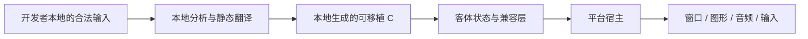

# RA3 · iOS / Android / Windows / macOS recompilation research

**红色警戒 3 静态重编译研究：公开方法、工程经验和少量通用工具。**

[English](README.en.md) · [架构](docs/ARCHITECTURE.md) · [方法](docs/METHOD.md) · [进度与限制](docs/STATUS.md) · [公开边界](LEGAL.md)

这个项目研究如何将旧有 x86 程序的执行语义转为可移植 C，并通过宿主兼容层连接现代平台的图形、音频、输入和文件系统。开发路线从 Windows 上的对照验证，扩展到 Android、macOS 和 iOS / iPad。

**这里是经过单独整理的部分开源版本，不是完整游戏移植源码，也不能直接构建或运行游戏。** 游戏代码及其反编译、lift、重编译表示，游戏资源、着色器及其转换结果，可运行游戏包和授权信息均不在本仓库中。拥有正版游戏也不会让本仓库自动成为完整构建工具链。

## 目前做到哪里

以下是截至 **2026-11-15** 的开发记录摘要，不是本仓库可复现的测试结果：

| 平台 | 开发记录中的结果 | 仍需验证 |
| --- | --- | --- |
| Windows x86 | 1.12 遭遇战整局由开发者实际完成 | 更广场景、长时间运行 |
| Android ARM64 | 1.12 进入战场、选中单位；片头音频和菜单已验证 | 完整对局、后台恢复、最新公共改动在真机上的回归 |
| macOS Apple Silicon | 1.12 菜单、战场、键鼠与动画光标已验证 | 完整对局、长期稳定性、图形覆盖 |
| iOS / iPad ARM64 | 已进入并操作对局；GPU 资源生命周期修补后的一轮真机复测通过 | 长时间压力、更多场景、性能代价 |

局域网目前只记录到 iPad 与 Mac 的房间互相发现；不宣称成功加入、完整混合平台对局或与原版 Windows 互通。详见 [状态与证据边界](docs/STATUS.md)。

## 思路



图中描述的是研究系统的分层，**不是本仓库已提供的模块列表**。

关键做法是先固定输入版本，明确客体与宿主的边界，再用小范围语义验证和实际运行逐步推进。CPU 状态、异常跳转、线程同步、图形资源寿命和输入坐标都需要显式设计，不能靠“能编译”判断正确。具体见 [方法](docs/METHOD.md) 和 [移植中的经验](docs/PORTING-NOTES.md)。

## 本次公开了什么

| 路径 | 内容 |
| --- | --- |
| `docs/` | 重新撰写的架构、流程、平台经验、验证方法与状态摘要 |
| `cmake/` | 从开发项目中抽出的 Dev / Release 配置模块与元数据模板 |
| `examples/build-profile/` | 无游戏依赖的 CMake 配置示例 |
| `tools/shotdiff.py` | 通用图像差异统计工具；不附带任何游戏图片 |
| `tools/publication_guard.py` | 文件白名单、文本/体积、敏感模式、Git 索引及历史检查 |
| `tests/` | 仅使用合成数据和临时仓库的公开工具测试 |
| `PUBLICATION.json` | 逐文件公开清单及来源类别 |

没有搬运原仓库的 Git 历史、LFS 指针或第三方源码。第一批范围刻意较小；后续候选模块必须先明确来源和依赖，再逐文件审查。

## 快速检查（不需要游戏）

需要 Python 3.10+、Git、CMake 3.16+；图像工具另外需要 Pillow。以下命令适用于 macOS / Linux shell；Windows 可使用 Git Bash 或等价的 Python/CMake 命令。

```sh
git clone https://github.com/HolyCaonima/ra3-ios-android-win-mac-recomp.git
cd ra3-ios-android-win-mac-recomp
python3 -m venv .venv
. .venv/bin/activate
python -m pip install -r requirements.txt
python -B tools/verify.py
git config core.hooksPath .githooks
```

`.venv/` 只允许存在于本地；索引和历史检查仍拒绝提交它。`verify.py` 检查当前目录、暂存内容、所有本地引用可达的提交历史，以及公开工具的合成测试。配置的 pre-commit hook 在提交前检查索引；[CI](.github/workflows/public-check.yml) 在推送和 PR 后执行完整检查。CI 不是发布前审查的替代品。

比较你自己有权使用的图片：

```sh
python tools/shotdiff.py /path/to/a.png /path/to/b.png /path/to/diff.png
```

图片和输出都保留在仓库之外。该指标只能帮助定位视觉差异，不代表渲染语义正确。

## 许可与致谢

本仓库发布的代码和文档使用 [MIT License](LICENSE)，允许按该许可使用、修改和再分发。MIT 不授予任何游戏、游戏资源或第三方软件的权利，也不附加“仅非商业使用”的限制。

说明组织方式参考了 [HolyCaonima/sc2-android-recomp](https://github.com/HolyCaonima/sc2-android-recomp) 对方法、工具和游戏派生物的区分；本文为重新撰写，没有复制其源码或文档段落。研究涉及的外部项目见 [致谢与来源](THIRD_PARTY.md)。

Command & Conquer、Red Alert 3 及相关名称、标识的权利属于各自权利人。本项目独立维护，未获 Electronic Arts 或其他权利人的认可或赞助。公开边界和贡献要求见 [LEGAL.md](LEGAL.md) 与 [CONTRIBUTING.md](CONTRIBUTING.md)。
