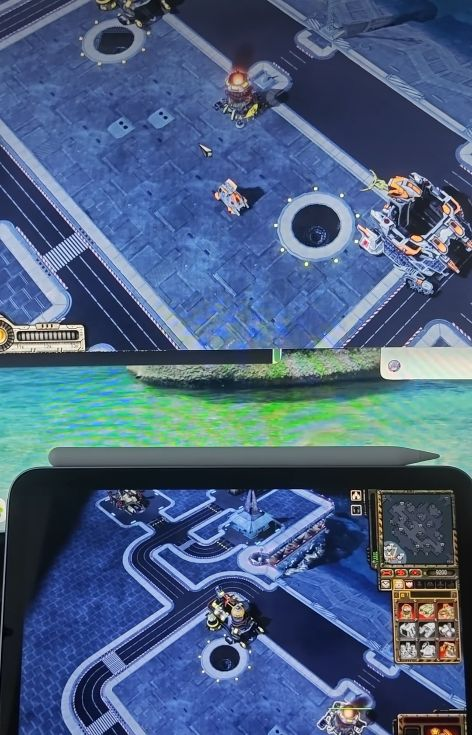
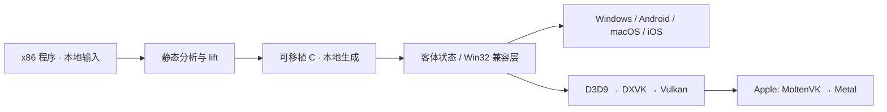

# Red Alert 3 — Native Recompilation

**[English](README.en.md)**

[](https://github.com/HolyCaonima/ra3-ios-android-win-mac-recomp/actions/workflows/public-check.yml)
[](LICENSE)
[](https://space.bilibili.com/3546857907162034)

**把《红色警戒 3》的 x86 执行逻辑静态重编译为 C，在 iPad、Android、Windows 和 macOS 上探索原生运行。**

从 Windows 上的整局遭遇战，到 Android 的战场、Apple Silicon 上的键鼠操作，再到 iPad 的苏军战役，这个仓库公开沿途用到的方法、资源处理工具、lifter 扩展、宿主组件和图形兼容补丁。

**2026-11-15 · iPad ↔ Mac 联机演示已更新：两端进入同一个房间并进入战场。** [观看实录 ↗](https://www.bilibili.com/video/BV1tZsH6gEGb/)

> 项目原创代码与文档采用 MIT。游戏资源本体、生成的 lift C 和游戏安装包不随仓库分发；第三方补丁保留上游许可，演示截图中的游戏画面不属于 MIT 授权。这里提供可复用的工程组件，尚不是完整游戏的一键构建工具链。

## 实机画面

[](https://www.bilibili.com/video/BV1E7sV6vEfn/)

*iPad · 苏军战役第一关。点击画面观看原视频。*

| Android · 战场与基地 | macOS · 单位选择与移动 |
| :---: | :---: |
| [](https://www.bilibili.com/video/BV1qDsE67ECV/) | [](https://www.bilibili.com/video/BV1jws56vE25/) |

<details>
<summary><strong>iPad ↔ Mac · 双端联机画面</strong></summary>
<br>
<p align="center">
  <a href="https://www.bilibili.com/video/BV1tZsH6gEGb/"></a>
</p>
</details>

*画面取自 [小小祁少的开发实录](https://space.bilibili.com/3546857907162034)，用于展示进度。[截图来源与时间点](docs/SCREENSHOTS.md)。*

## 目前能做到什么

截至 **2026-11-15**。平台结果来自开发测试与实录；公开仓库的 CI 单独验证工具和合成用例。

| 平台 / 子系统 | 已验证进展 | 下一步 |
| --- | --- | --- |
| **Windows x86** | 1.12 遭遇战整局完成 | 更多地图、长时间运行 |
| **Android ARM64** | 菜单、片头音频、进入战场和单位选择 | 完整对局、后台恢复回归 |
| **macOS · Apple Silicon** | 战场、地形 / HUD、键鼠和动画光标 | 整局与图形覆盖 |
| **iOS / iPad ARM64** | 战役实机操作；GPU 生命周期修补后一轮复测通过 | 长时间运行、资源保留成本 |
| **iPad ↔ Mac LAN** | 同房间、双端进入战场 | 整局同步、原版 Windows 互通 |
| **公开工具与补丁** | 资源处理、宿主组件、14 个 DXVK 补丁、MoltenVK 修补 | 持续拆分并公开其余原创模块 |

ARM64 上完整的 x86 内存序保证仍是待解决项。详细结果与验证边界见 [项目状态](docs/STATUS.md)。

## 从哪里开始

**不需要游戏文件，就可以运行公开组件的测试。** 需要 Python 3.10+、Git、CMake 3.16+ 和 C 编译器；完整宿主测试适用于 macOS / Linux。

```sh
git clone https://github.com/HolyCaonima/ra3-ios-android-win-mac-recomp.git
cd ra3-ios-android-win-mac-recomp
python3 -m venv .venv
. .venv/bin/activate
python -m pip install -r requirements.txt
python -B tools/verify.py
```

要研究具体模块，从 [工具与组件指南](docs/TOOLS.md) 开始。要复用渲染器补丁，见 [DXVK](tools/dxvk/README.md) 和 [MoltenVK](tools/moltenvk/README.md)。

## 移植路线



1. **固定输入。** 记录版本、哈希和资源配置链，让代码与资源来自同一套输入。
2. **补齐翻译语义。** 处理 SSE 整数运算、原子读改写和非局部跳转，遇到未支持指令明确失败。
3. **建立宿主契约。** 把地址空间、文件路径、线程、输入与客体状态分开管理。
4. **接通图形。** 处理移动 GPU 的可选扩展、采样器特化、窗口生命周期与坐标映射。
5. **处理 Apple 差异。** 接入 Metal surface，修正顶点 stride 与 GPU buffer 生命周期问题。
6. **用证据推进。** 先跑合成测试和小范围差分，再看实机画面、操作、完整对局与长时间运行。

[研究方法](docs/METHOD.md) · [架构](docs/ARCHITECTURE.md) · [移植经验](docs/PORTING-NOTES.md)

## 仓库里有什么

| 路径 | 内容 |
| --- | --- |
| [`tools/resources/`](tools/resources/) | BIG / CSF 读写、RefPack 解压、SkuDef 配置链解析；不附资源 |
| [`tools/versions/`](tools/versions/) | 本地 Steam depot manifest 解析，不访问账号或服务 |
| [`tools/lift/`](tools/lift/) | 原子操作与 SSE lifter 扩展、setjmp / longjmp 转换、PE32 导入查看 |
| [`runtime/hle/`](runtime/hle/) | UDP 局域网发现传输、UTF-16 路径组合 |
| [`hosts/`](hosts/) | CUR / ANI 光标解码、Apple Bonjour 与 Android NSD 桥接 |
| [`tools/dxvk/`](tools/dxvk/) | **14 个平台补丁**、外部目录构建脚本、iOS stride 回归检查 |
| [`tools/moltenvk/`](tools/moltenvk/) | iOS GPU buffer 生命周期补丁、构建脚本、原生 Metal 探针 |
| [`cmake/`](cmake/) · [`examples/`](examples/) | Dev / Release 构建配置与独立示例 |
| [`tests/`](tests/) · [`tools/shotdiff.py`](tools/shotdiff.py) | 合成回归测试、图像差异统计与公开内容检查 |

源码、脚本与方法会继续整理公开。完整宿主集成和部分运行时依赖尚未包含；各组件的可运行范围写在 [工具指南](docs/TOOLS.md)，逐文件来源见 [PUBLICATION.json](PUBLICATION.json)。

## 后续方向

- 完成 Android、macOS、iPad 的整局与长时间回归。
- 验证跨平台联机同步，并单独检查与原版 Windows 的互通。
- 继续处理 ARM64 内存语义、图形兼容与资源生命周期。
- 继续拆出可复用的原创运行时和测试工具，补齐公开组件之间的集成。

## 许可与致谢

原创代码和文档使用 **[MIT License](LICENSE)**。DXVK 补丁保留 zlib/libpng 许可，MoltenVK 补丁保留 Apache-2.0 许可；完整声明见 [THIRD_PARTY.md](THIRD_PARTY.md) 与 [LICENSES/](LICENSES/)。游戏画面与相关商标归各自权利人所有，本项目与 Electronic Arts 无隶属或赞助关系。[公开范围](LEGAL.md) · [贡献指南](CONTRIBUTING.md)。

README 的组织方式参考 **[elkir0/sc2-android-recomp](https://github.com/elkir0/sc2-android-recomp)**。感谢原作者 elkir0 公开其静态重编译方法与工程经验，以及 [pcrecomp](https://github.com/sp00nznet/pcrecomp)、[DXVK](https://github.com/doitsujin/dxvk)、[MoltenVK](https://github.com/KhronosGroup/MoltenVK) 等上游项目。
